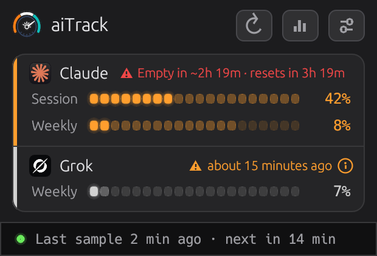
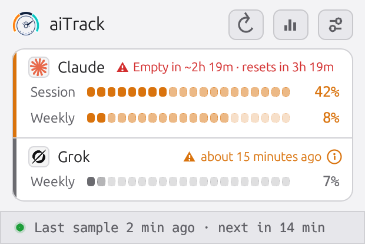
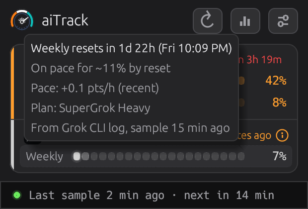
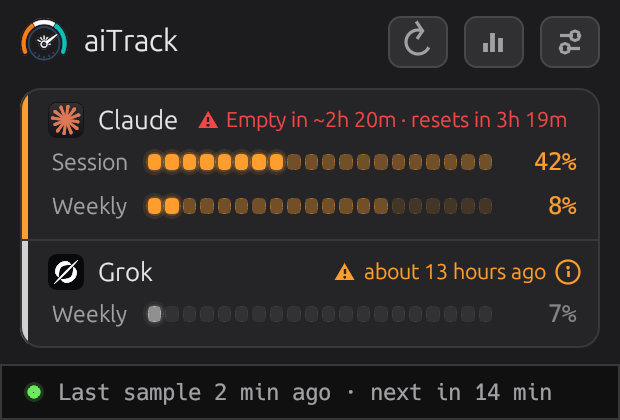
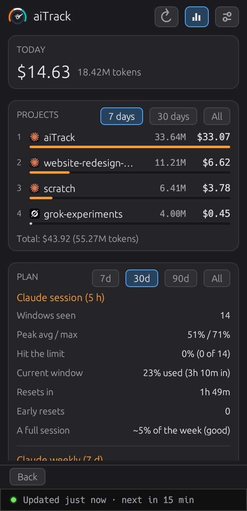
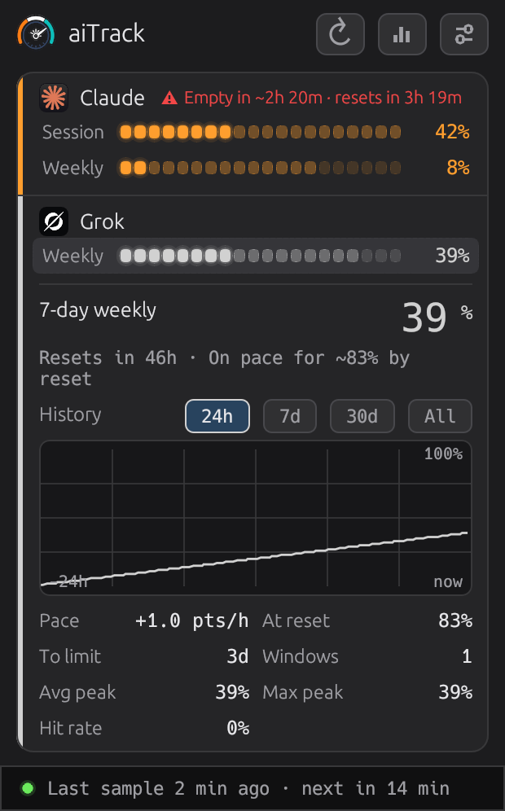
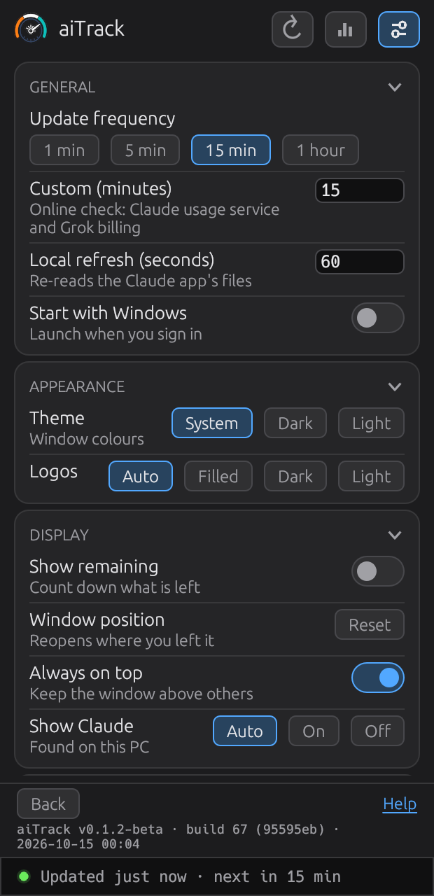

# aiTrack

aiTrack is a small window for **Windows**, **macOS** and **Linux** that shows how much of your **Claude** and **Grok** plan
limits you have used. It stays on top of your other windows, updates by itself, and warns you with a normal system
notification before a limit runs out. The Mac version is for Apple silicon. Linux (new) is a first release for Ubuntu
that has not yet been run on a real desktop by the maintainer (see [section 15](#15-known-limits-and-roadmap)). Where
this guide names Windows, Mac or Linux, it applies to that system only.




*The pictures in this guide use sample numbers.*

This guide is for people who just want to run it. Deeper technical notes are at the end, under
[Details](#details).

## Contents

1. [What aiTrack is](#1-what-aitrack-is)
2. [Requirements](#2-requirements)
3. [Install and run](#3-install-and-run)
4. [What it tracks and where the numbers come from](#4-what-it-tracks-and-where-the-numbers-come-from)
5. [Grok needs the Grok CLI](#5-grok-needs-the-grok-cli)
6. [Reading the window](#6-reading-the-window)
7. [Stats view](#7-stats-view)
8. [History chart](#8-history-chart)
9. [Alerts](#9-alerts)
10. [Settings](#10-settings)
11. [Clicking the logos](#11-clicking-the-logos)
12. [Files and privacy](#12-files-and-privacy)
13. [Troubleshooting](#13-troubleshooting)
14. [Command-line flags](#14-command-line-flags)
15. [Known limits and roadmap](#15-known-limits-and-roadmap)

## 1. What aiTrack is

Claude and Grok limit how much you can use them. Claude has a **5-hour session** limit and a **7-day weekly**
limit. Grok has one **weekly** credit pool. Each tool shows its own numbers in its own place, and it is easy to
hit a limit without seeing it coming.

aiTrack puts those numbers in one small window:

- a bar and a percentage for each limit, and when it resets;
- a warning when you are on course to run out before the reset;
- a history chart for each limit;
- a Stats view with your token use and cost per project;
- notifications (Windows toasts, Mac banners or Linux desktop notifications) at 75 %, 90 % and 100 %.

It runs on your computer and reads files that Claude and Grok already keep there. It only talks to the internet when
those files have nothing recent (see [Files and privacy](#12-files-and-privacy)). A tool's block appears only
when that tool is installed.

> **Keep the tool running for fresh numbers.** Claude's numbers come from the Claude desktop app's cache, which
> only updates while the Claude app is running and talking to Claude. With the app closed, aiTrack keeps showing
> the last value with the amber age chip (dimmed after 60 minutes), and the status bar says the app is not running.
> Grok's numbers update when the Grok CLI runs (**Refresh Grok now** starts it briefly). To keep Claude live without
> the desktop app, sign in to Claude Code (run `claude`, then `/login`) so the usage-service fallback can work; that
> fallback is not yet tested on the owner's PC.

Release status: 0.3.0 is the first official release, tested on Windows (0.2.0 was an earlier test release). The Mac
version has been checked on one Apple silicon Mac. Linux (new) has not yet been run on a real desktop by the
maintainer. You can download an installer, a portable zip, a Mac disk image or a Linux `.deb` (see
[section 3](#3-install-and-run)) or build it from source. aiTrack is free software under the GNU General Public
License, version 3 or later (see `LICENSE`).

## 2. Requirements

- **Windows**: Windows 10 or 11. (The notifications use Windows 10 features. I have not tested older versions.)
- **Mac**: a Mac with Apple silicon (M1 or later) on the latest macOS. Intel Macs are not built.
- **Linux (new)**: Ubuntu 22.04 or newer (or a Debian-based system with the same libraries), x86_64, with a desktop
  session. GNOME on Wayland is the main target; X11 also works. Notifications need `notify-send` (package
  `libnotify-bin`).
- At least one of the tools it tracks, already installed and signed in:
  - **Claude**: the Claude desktop app, or Claude Code.
  - **Grok**: the Grok command-line tool (the "Grok CLI"). See [section 5](#5-grok-needs-the-grok-cli).
- To build it yourself: Git and Rust (steps below; on a Mac also the Xcode command line tools; on Linux the build tools and the X11 and Wayland development packages). You do not need Rust to run a downloaded copy.

## 3. Install and run

You can download a ready-made copy (the easy way) or build it yourself from the source code. The steps below are
for Windows; the Mac steps are in [Install on a Mac](#install-on-a-mac) and the Linux steps in
[Install on Linux](#install-on-linux-new).

### Download and install (Windows)

Go to the **Releases** page of the repository (https://github.com/genen/aiTrack/releases) and open the newest
release (the one marked **Latest**). Releases marked "Pre-release" are test builds. Under **Assets** there are three files:

- **`aiTrack-Setup-<version>-win-x64.msi`**: the installer. It installs aiTrack for all users in
  `C:\Program Files\aiTrack`, adds Start menu and desktop shortcuts, and asks for administrator permission.
  Double-click it, accept the licence (GPL-3.0-or-later), pick the folder, and click **Install**. On the last page,
  **Run after install?** is ticked: leave it ticked to start aiTrack at once.
- **`aiTrack-Setup-<version>-win-x64-msi.zip`**: the same installer inside a zip, with this README (`README.md`, and
  `README.pdf` to read offline), `LICENSE` and the pictures in `docs\img`. If your browser blocks the `.msi`
  download, use this one: unzip it and double-click the `.msi` inside (it is the same file, same checksum).
- **`aiTrack-<version>-win-x64.zip`**: the portable copy. Unzip it anywhere (for example your Documents folder) and
  double-click `aitrack.exe`. It needs no installer and no administrator rights. It keeps its data in the same
  `~/.aitrack` folder. The zip also holds `LICENSE`, `README.md` (with its pictures in `docs\img`) and `README.pdf`.

**"Windows protected your PC" (SmartScreen).** These builds are not code-signed yet, so Windows shows the
publisher as "Unknown". Windows may also show this for the zip's `aitrack.exe`. If you trust the download:

1. In the blue window, click **More info**.
2. Click **Run anyway**.

(For the MSI, the permission window then says "Unknown publisher"; click **Yes**.) Each release lists SHA256
checksums in its notes. To compare: `Get-FileHash .\aiTrack-Setup-<version>-win-x64.msi` in PowerShell.

**Windows Security may block the download.** In October 2026 Microsoft Defender began flagging the unsigned Windows
downloads (and an installed copy) as `Trojan:Win32/Cloxer`. I believe this is a false positive: the same code built on
my own PC was not flagged, and 70 of 71 scanners on VirusTotal found nothing in that build. I cannot prove it, and I
have reported it to Microsoft. If you cannot download the files, build from source (see "Build it yourself"), which
produces a program Defender did not flag. Do not add an exclusion unless you have decided to trust the download.
Compare the SHA256 in the release notes with `Get-FileHash` before you run anything.

**Update.** Run the newer MSI. It replaces the old version and keeps your settings. It refuses to install an older
version over a newer one. For the zip, replace `aitrack.exe`.

**Install without prompts.** For a managed PC, from an administrator PowerShell:
`msiexec /i aiTrack-Setup-<version>-win-x64.msi /qn`. A silent install never starts the program.

**Uninstall.** Open Windows **Settings > Apps > Installed apps**, find **aiTrack** and choose **Uninstall** (or use
Control Panel > Programs). This removes the program, its shortcuts and the "Start with Windows" entry of the user who
uninstalls. It **keeps your data** in `C:\Users\<you>\.aitrack` (history, settings). Delete that folder yourself if
you want it gone. Another user of the same PC keeps their own "Start with Windows" entry until they turn that setting
off. To remove the portable copy, delete its folder (and turn off **Start with Windows** first).

### Build it yourself (Windows)

Skip this if you downloaded aiTrack above. You build it once from the source code, then run the program.

Open **PowerShell** (not the old "Command Prompt") and follow these steps.

**Step 1. Install Git and Rust** (skip what you already have). Either use `winget`, which comes with current
Windows:

```
winget install --id Git.Git -e
winget install --id Rustlang.Rustup -e
```

or download Git from https://git-scm.com and Rust from https://rustup.rs. The Rust installer may ask you to
install the "Visual Studio C++ Build Tools" first; accept that, it is what Rust needs to build programs on
Windows. Close PowerShell and open a new one afterwards so it finds the new tools.

Check that both work:

```
git --version
cargo --version
```

aiTrack needs **Rust 1.89 or newer**. A fresh install gives you the latest. If you already had Rust, run
`rustup update` first; an older one stops with a message about the required `rust-version`.

**Step 2. Get the code and build it.** Pick a folder you will keep (the example uses `D:\git`):

```
git clone https://github.com/genen/aiTrack.git D:\git\aiTrack
cd D:\git\aiTrack
cargo run --release
```

The first build downloads and compiles a lot and takes several minutes. When it finishes, the aiTrack window opens.

**Where the program is.** `cargo run --release` builds `aitrack.exe` in `D:\git\aiTrack\target\release\`. You can
start it from there later by double-clicking it, or from PowerShell with `.\target\release\aitrack.exe`. Pin it to
the taskbar if you like. Only one aiTrack window runs at a time: starting it again brings the first one to the
front.

**Update to a newer version.** An old copy that is still running blocks the build ("Access is denied"), so stop it
first:

```
cd D:\git\aiTrack
Get-Process aitrack -ErrorAction SilentlyContinue | Stop-Process
git pull
git log --oneline -1
cargo run --release
```

The line at the bottom of Settings (and `aitrack --version`) names the version, build number and commit. The
number in brackets should match the commit that `git log --oneline -1` printed.

**Start with Windows.** In Settings > General, turn on **Start with Windows**. aiTrack then starts when you sign in.
It does this by adding a value named `aiTrack` under `HKEY_CURRENT_USER\Software\Microsoft\Windows\CurrentVersion\Run`
that points at the exe you are running now. If you later move the exe, turn the setting off and on again.

### Install on a Mac

Apple silicon only (M1 and later).

**Download.** Once a Mac release is published, open the **Releases** page (https://github.com/genen/aiTrack/releases)
and download `aiTrack-<version>-macos-arm64.dmg` (or the `.zip` with the same app inside). Open the dmg and drag
**aiTrack** to **Applications**.

**First open.** The app is only ad-hoc signed: it has no Apple developer signature and is not notarized, so macOS
stops it the first time. Either right-click the app and choose **Open**, then **Open** again; or try to open it once,
then go to **System Settings > Privacy & Security** and click **Open Anyway**. You do this once per copy.
Once signed and notarized releases are published (the release text will say so), the app will open normally
without this step; see `docs/MAC-SIGNING.md`.

**Build it yourself.** Install Rust from https://rustup.rs (Rust 1.89 or newer; run `rustup update` if you already
had it) and the Xcode command line tools (`xcode-select --install`). Then, in Terminal:

```
git clone https://github.com/genen/aiTrack.git
cd aiTrack
cargo run --release
```

That opens the window straight from the build. To get a proper app with the aiTrack icon and name in the Dock:

```
cargo build --release
scripts/make-app.sh
open dist/aiTrack.app
```

Only one aiTrack runs at a time. Starting it again brings the running window to the front, so quit an old copy
before you try a new build (see [Troubleshooting](#13-troubleshooting)).

**Start at login.** In Settings > General, turn on **Start at login**. aiTrack writes a LaunchAgent named
`com.sirgene.aitrack` in `~/Library/LaunchAgents`. macOS shows a "Background Activity" notice, and the change
applies at your next sign in. If you later move the app, turn the setting off and on again.

**Uninstall.** Quit aiTrack, turn off **Start at login**, and drag `aiTrack.app` to the Bin. Your data stays in
`~/.aitrack`; delete that folder yourself if you want it gone.

### Install on Linux (new)

Ubuntu 22.04 and newer, x86_64. This is a first release: it has not yet been run on a real desktop by the maintainer.

**Download and install.** On the **Releases** page (https://github.com/genen/aiTrack/releases) download
`aitrack_<version>_amd64.deb` and install it (apt resolves the libraries):

```
sudo apt install ./aitrack_<version>_amd64.deb
```

Then start **aiTrack** from the applications menu, or run `aitrack`. The package also holds this guide
(`/usr/share/doc/aitrack/README.pdf`) and the licence.

**Wayland and XWayland.** On a Wayland session (GNOME on Ubuntu) aiTrack starts through XWayland by default, because
native Wayland has no "always on top" and lets an app neither read nor set its own window position. Set
`AITRACK_WAYLAND=native` to run natively: the width is still remembered, but the position is not, and **Always on top**
is not available (use the title-bar menu, Alt+Space on GNOME, per session). Under XWayland, text can look slightly soft
with fractional display scaling.

**Start at login.** In Settings > General, turn on **Start at login**. aiTrack writes
`~/.config/autostart/aitrack.desktop` (or under `$XDG_CONFIG_HOME`). If you later move the program, turn the setting off
and on again.

**Uninstall.** `sudo apt remove aitrack`. Your data stays in `~/.aitrack`; delete that folder yourself if you want it
gone.

## 4. What it tracks and where the numbers come from

aiTrack never asks you to paste a key. It uses what the tools have already stored on your PC.

### Claude

Claude shows two bars: **Session** (5 hours) and **Weekly** (7 days). Each poll tries these sources in this
order and uses the first one that is recent:

1. **Claude desktop app cache.** The desktop app keeps its last "usage" answer in its own cache folder. This has
   the percentages and the reset times, and needs no login. The folder is `%APPDATA%\Claude`, or for the
   Microsoft Store version `%LOCALAPPDATA%\Packages\Claude_*\LocalCache\Roaming\Claude`. On a Mac it is
   `~/Library/Application Support/Claude`. On Linux it is `$XDG_CONFIG_HOME/Claude`, else `~/.config/Claude` (Flatpak
   and Snap folders are also checked, as a guess).
2. **Claude desktop app history.** A second file of the app (`plan-usage-history.json`). It has percentages but no
   reset times, so aiTrack carries the reset time over from an earlier reading (see
   [Reading the window](#6-reading-the-window)).
3. **Claude Code's `~/.claude.json`.** A saved usage figure, used only if it belongs to the account that is
   signed in.
4. **The Claude usage service.** As a last resort aiTrack asks the same online service that Claude Code's `/usage`
   command uses, with the sign-in Claude Code stored in `~/.claude/.credentials.json`. This is the only source that
   needs the internet. It is asked only when none of the files above has a recent reading.

**The Claude desktop app has to be running** for sources 1 and 2 to update: its cache and history only change while
the app is open and talking to Claude. With it closed, aiTrack keeps the last value with the age chip. Signing in to
Claude Code (`claude`, then `/login`) lets source 4 take over (untested on the owner's PC).

**On a Mac** the Claude app also has to be running. As far as I have seen, the cache changes only when the Claude app
itself fetches your usage (for example when you open its usage page), so the numbers can be old even while the app
is open. That is what I observed, not something Claude promises. If the bars show dashes or an old value, open the
usage page in the Claude app and press **Refresh now**. Source 4 reads `~/.claude/.credentials.json`, and on a Mac
also the Keychain item "Claude Code-credentials" (macOS may ask you to allow it). I could not test the Keychain read:
that item does not exist on the Mac I tested on.

**On Linux** the Claude desktop app keeps its sign-in in the system keyring (GNOME Keyring), so
`~/.claude/.credentials.json` may be absent. That is normal: aiTrack then shows the last reading dimmed, or "no Claude
data found", and never an error dialog. aiTrack never reads the keyring. Whether the Linux desktop app's cache files
parse like the Windows ones is not yet verified; if `aitrack --sources` says "usage entries found: 0", the reading falls
back to `~/.claude.json`.

**Keychain access dialog (Mac).** The first time aiTrack reads that Keychain item, macOS may ask whether to allow it;
choose **Allow** or **Always Allow**. If the dialog is left unanswered, aiTrack waits about 10 seconds, then gives up on
the Keychain for that round and carries on with the other Claude sources (desktop cache, history, `~/.claude.json`), so
the window keeps updating. Not every Mac has this item. This path is unverified on a real Mac.

Claude's panel appears when the desktop app's data folder or Claude Code's folder (`~/.claude`, or the folder in
`CLAUDE_CONFIG_DIR`) exists.

### Grok

Grok shows one bar: **Weekly**, the credit pool of your current billing period. aiTrack uses:

1. **Live billing.** It asks Grok's billing service (the same one the Grok CLI uses) with the sign-in the CLI
   stored in `~/.grok/auth.json`.
2. **The CLI's log.** The CLI writes a line to `~/.grok/logs/unified.jsonl` each time it fetches billing. aiTrack
   reads the newest one. It is only as fresh as the last time the CLI ran.

Both need the Grok CLI. See the next section.

#### The Grok Bot bar (macOS and Windows)

If the **Grok Bot** app is installed, a second bar labelled **Grok Bot** appears under **Weekly**. It is the app's
own "Weekly Grok Bot Limit", a separate meter from the SuperGrok weekly pool (the Grok CLI's log has no field for it).
aiTrack reads the small cache file the app keeps in its data folder: `~/Library/Application Support/Grok Bot/` on a
Mac, `%APPDATA%\Grok Bot\` on Windows (the subfolder `sand-client-persistence`). It opens only the one file that holds
the weekly usage, never the app's login or secrets files, and it records no account id or file name anywhere.

Known limits:

- **Unverified layout.** The file layout was reported by the Grok Bot assistant from the owner's Mac and PC and matches
  the app's Usage page by value (percentage and reset time). aiTrack's authors have not seen the files themselves. If
  an app update changes the layout, the bar simply disappears.
- **Only fresh while Grok Bot is open, and only every half hour or so.** Checked on a Mac and a PC with the app open:
  it rewrote the file 28 to 40 minutes apart, at irregular times. So a reading 20 to 40 minutes old is normal. The
  bar keeps the last value; after 60 minutes it is dimmed and the header shows an age label (also in the tooltip). It
  shows dashes once that weekly period has ended.
- It is shown only inside the Grok block, so the Grok CLI must still be found. No alerts for this bar yet.
- `aitrack --sources` lists it as found, stale or not found (no paths with ids).

## 5. Grok needs the Grok CLI

aiTrack reads Grok usage from the folder of the Grok **command-line tool** (`~/.grok`, which is
`C:\Users\<you>\.grok` on Windows, `/Users/<you>/.grok` on a Mac and `/home/<you>/.grok` on Linux). The Grok desktop apps ("Grok" and "Grok Bot") do not leave anything there that aiTrack
can read. **Without the Grok CLI installed, the Grok block stays hidden.**

### Install the Grok CLI

xAI publishes a PowerShell installer: https://x.ai/cli/install.ps1. xAI's own instructions are at
https://x.ai/build.

**Read a script before you run it.** The installer downloads and installs a program, so open
https://x.ai/cli/install.ps1 in your browser and read it first, or ask someone you trust to. I read the current
version of the script. This is what it does:

- downloads the Grok CLI from `https://x.ai/cli` (or, if that fails, from Google Cloud Storage);
- puts `grok.exe` and `agent.exe` in `C:\Users\<you>\.grok\bin`;
- may also install helper programs and a small bundled copy of Git (in `%LOCALAPPDATA%\grok\git`);
- writes `~\.grok\config.toml`;
- adds `C:\Users\<you>\.grok\bin` to your **user** PATH, which only new PowerShell windows pick up;
- does not sign you in.

The usual way to run it, as written in the script's own header, is this one line in PowerShell:

```
irm https://x.ai/cli/install.ps1 | iex
```

(`irm` downloads the script and `iex` runs it. That is why reading it first matters. Scripts change, so check
https://x.ai/build for the current steps if this does not work.)

**On Linux** run `grok` once in a terminal and sign in; aiTrack looks in `~/.grok/bin`, `~/.local/bin` and on your PATH.

**On a Mac** the CLI is usually at `~/.local/bin/grok` or in `~/.grok/bin`; aiTrack looks in both and on your PATH.
Install it with xAI's instructions at https://x.ai/build (read any install script before you run it). The Grok Bot
app on its own is not enough: aiTrack needs the CLI's `~/.grok` folder. Run `grok` once in Terminal and sign in.

### Sign in

Open a **new** PowerShell window and run:

```
grok
```

Sign in when it asks (aiTrack's own messages say "run `grok` and sign in"; the installer's header comment also
mentions a `grok login` command). Use the xAI account you use for Grok, then quit the CLI. The CLI stores your
sign-in in `~/.grok/auth.json`.

You do not have to restart aiTrack. It notices the `~/.grok` folder within a few seconds and shows the Grok block.
The first number arrives at the next online check (every 15 minutes by default). Press **Refresh now** in the
header to ask at once.

### If Grok shows old data or "login expired"

- The CLI writes the log line aiTrack needs only when it runs. If Grok shows an old value with an amber age
  label, press **Refresh** under the Grok row (or **Refresh Grok now** in Settings). aiTrack then starts the CLI
  in the background for a moment, with no window, and closes it again. It never sends a prompt, so it uses no
  credits, and it does nothing while you have `grok` open yourself.
- If the message says **Grok login expired**, run `grok` once yourself, or use **Refresh Grok now**. The CLI
  renews its sign-in when it starts.
- If a refresh says `no new data (Grok did not fetch billing)`, run `grok` yourself, check that you are signed
  in, and try again.

### `grok` is not found

The installer adds the CLI to your user PATH, but a PowerShell window opened before the install does not see it
yet. aiTrack does not depend on PATH. It looks for `grok.exe` on PATH and also in `~\.grok\bin`,
`~\.grok\versions\*`, `~\.local\bin`, `%LOCALAPPDATA%\Programs\grok` and a few other usual places. If your copy is
somewhere else, the **Refresh** button is hidden (the live billing and the log still work if `~\.grok` exists).

## 6. Reading the window

The window has a header with three buttons, one block per tool, and a status line at the bottom.

- Header buttons: **Refresh now** (the circular arrow, polls at once), **Stats** (the bars icon) and
  **Settings** (the sliders icon).
- Each tool block has a logo, the tool's name and one bar per limit. Clicking the logo opens the tool
  (see [Clicking the logos](#11-clicking-the-logos)).

### The bars

Each bar has 20 segments in the tool's colour (Claude amber, Grok light grey). Read it left to right:

- **bright**: what you have used so far;
- **medium**: the extra use expected by the time the window resets if you keep your current pace;
- **dark**: what is left.

A bar and its number turn **red at 90 % used**. In Settings you can switch **Show remaining** on to count down
what is left instead.

### Session and weekly

Claude's **Session** window lasts 5 hours. Its **Weekly** window lasts 7 days. Each has its own reset time. Grok has only a **Weekly** window (your billing period).

### Hovering and clicking a row

Hover a row to see a tooltip: when the window resets, the pace, and where the number came from.



Click a row to open a detail pane with the pace, the projected use at the reset, time to the limit, window
statistics and a [history chart](#8-history-chart). Click again to close it.

### Reset times and "carried"

Some sources give percentages without a reset time. aiTrack then reuses the latest reset time it stored for that
window, but only while that time is still in the future, the reading fits inside that window, and the percentage
has not dropped. The tooltip then says, for example, "Session resets in ~1h 13m (carried from earlier sample)".
The `~` means "estimated". If aiTrack knows nothing, it says "reset time unknown". It never invents a time and never
shows a time in the past.
When the reset time a reading itself reported has passed, that window is over and the number belongs to it. The row
then shows dashes with "its reset time has passed, waiting for a new reading" until the next reading arrives.

### Pace and the "Empty in" warning

aiTrack compares your use so far with the time that has passed in the window. If you would run out **before the
window resets**, a red line appears after the tool's name, for example `Empty in ~2h 19m · resets in 3h 19m`. The
row tooltip says "Limit in ~1.4h at this pace".

The warning is held back when it would be noise:

- there is no reset time;
- the usage is still low (under 10 % for the session, under 25 % for the week) unless even your average pace would
  use up the window;
- the reading is more than 60 minutes old (see below).

### Old data

Each source updates at its own speed, so a number can be a little old.

- After 15 minutes (files on your PC) or about two poll intervals, at least 10 minutes (online sources), an
  amber label appears at the right of the tool's name with the age, for example "about 13 hours ago". Hover it to
  see what to do.
- After **60 minutes** the number is shown dimmed, the tooltip ends with an amber "Data is about 2 h old" line, and
  the "Empty in" warning and the pace lines are left out, because a pace from an old reading says nothing about
  now.
- **Claude** shows dashes (`--`) and "No current data" when no source has given a reading for about two hours
  (for example the Claude app was closed all day). Open the app and press **Refresh now**.
- **Grok** keeps its last value however old (dimmed). It shows dashes only when its billing period has ended, because
  the old number belongs to last week.



### The status line

The line at the bottom says when the last sample was taken and when the next check is due, for example
`Updated 1 min ago · next in 14 min`. A green dot means fine, amber means the data is getting old, red means the
last check failed (hover for the full text).

## 7. Stats view

Click the **Stats** button (the bars icon). It shows three cards and has a **Back** button at the bottom.



- **Today**: the cost and token count of today, from your local transcripts.
- **Projects**: your projects ranked by cost, with tokens and a bar. Choose **7 days**, **30 days** or **All**.
  Claude Code projects come from `~/.claude/projects`. Grok projects come from `~/.grok/sessions` and
  `~/.grok/logs`. Grok sessions that only appear in the log have tokens but no cost (shown as `n/a`). aiTrack
  reads token counts, model names and project names. The text of your prompts and the answers is dropped as the
  files are read and is never stored. Each row starts with the small Claude or Grok logo, and hovering a row
  names the vendor and its numbers. Projects of the same name from different tools stay separate rows.
- **Plan**: statistics about your limit windows for each tool. Choose **7d**, **30d**, **90d** or **All**. Rows
  include *Windows seen*, *Peak avg / max*, *Hit the limit*, *Current window*, *Resets in*, *Early resets*, and (for
  Claude) *A full session*, which says how much of the week one full session costs, once there is enough data.
  When the Grok Bot app is tracked and has stored readings, a separate **Grok Bot weekly** block follows
  **Grok weekly** with the same rows (weekly only), from its own history file.

Costs are estimates at API list prices (USD per million tokens). The price list is downloaded from GitHub about
once a day, with a built-in table as a fallback. They are not what your plan charges. The view rescans every five
minutes and shows "updating..." while it works.

## 8. History chart

Click a row to open its detail pane; the chart is under **History**.



- Choose **24h**, **7d**, **30d** or **All**.
- Until you choose, it opens on the shortest range that shows everything stored: under a day of data opens
  **24h**, under a week **7d**, under 30 days **30d**, otherwise **All**. When you pick a range, aiTrack keeps your
  choice.
- The line is one connected line. It is cut only where there is a gap of more than two hours, or where a limit
  window resets. A lone reading is a dot.
- When all the data in the range is at or under 25 %, the vertical scale is zoomed (top 10, 20, 25 or 50 %, shown
  at the top right). Otherwise the scale is 0 to 100 %.

## 9. Alerts

aiTrack sends Windows notifications (toasts) while the window is running. They are ordinary toasts that go away on
their own. They carry the tool's logo. On a Mac they are ordinary notification banners (see **On a Mac** below); on
Linux they are desktop notifications (see **On Linux** below).

| Alert | When | Sound |
|---|---|---|
| Info | a window passes 75 % used | silent |
| Warning | passes 90 % ("10% left") | reminder sound |
| Limit | reaches 100 % | reminder sound |
| Predictive | you would run out within 30 minutes, before the reset | reminder sound |
| Recovery | a window that reached 90 % or more has reset and you are below 90 % | Windows default |

- Each alert fires **once per limit window**. aiTrack remembers what it sent in `~/.aitrack/alerts.json` (and
  `alerts-grok.json`), so restarting does not repeat it.
- If you jump past a level, only the highest one is announced.
- Alerts need the window to be running. Closed means no alerts.
- Old readings do not trigger alerts.

In Settings > Notifications you can turn **Usage alerts** off, turn **Alert sounds** off, and press **Info**,
**Warning** or **Limit** under "Send a test toast" to see how each one looks.

**Sound.** The warning, limit and predictive toasts ask Windows for its "reminder" sound. Windows only plays it if
notification sounds are switched on: Settings > System > Notifications > **Allow notifications to play sounds**.
Hover **Alert sounds** in aiTrack's Settings for the same reminder. If you do not hear it, check that setting, and
that Focus assist or Do not disturb is off, before suspecting aiTrack.

**On a Mac.** When you run `aiTrack.app`, alerts are native macOS notifications with the aiTrack icon. The first
time, macOS asks whether aiTrack may send notifications: allow it (System Settings > Notifications > aiTrack). When
the program runs outside the app bundle (for example `cargo run --release`), macOS does not let it register for
notifications, so aiTrack falls back to simple banners shown through Script Editor; they work the same but carry
Script Editor's name and icon, and their sound setting is under Script Editor in System Settings > Notifications.
A **Focus** mode such as Sleep or Do Not Disturb hides the banners. **Send a test toast** is the quickest check.

**On Linux** alerts are desktop notifications sent with `notify-send` (package `libnotify-bin`, recommended by the
`.deb`). If it is missing, the alert is only written to `~/.aitrack/notify.log`. GNOME plays its own notification
sound, so **Alert sounds** only reminds you of that; Do Not Disturb hides the banners. **Send a test toast** is the
quickest check.

## 10. Settings

Click the sliders icon. The sections can be collapsed; **General** is open at first and the others are collapsed.
At the bottom: **Back**, a **Help** link (it opens this page), and the build line (click it to copy).



**General**

- **Update frequency**: **1 min**, **5 min**, **15 min** (the default) or **1 hour**. This is how often the online
  check runs. The online check is the Claude usage service and Grok billing, and it is only asked when no file on
  your PC has a recent reading. Every minute may hit rate limits.
- **Custom (minutes)**: any number of minutes, 1 to 1440.
- **Local refresh (seconds)**: how often aiTrack re-reads the files of the Claude app. Default 60, allowed 15 to 600.
- **Start with Windows** (on a Mac or Linux **Start at login**): start aiTrack when you sign in.

**Appearance**

- **Theme**: **System** (follows Windows, macOS or the desktop), **Dark** or **Light**.
- **Logos**: the look of the logo squares: **Auto** (dark logos on a dark window, light logos on a light one),
  **Filled**, **Dark** or **Light**.

**Display**

- **Show remaining**: show what is left instead of what is used.
- **Window position**: the window reopens where you left it. **Reset** forgets the position.
- **Always on top**: keep the window above other windows (on by default). On Linux under native Wayland it shows
  "Not available on native Wayland" (see [Install on Linux](#install-on-linux-new)).
- **Show Claude** and **Show Grok**: **Auto** (show it when the tool is found on this PC; the line under the name says
  "Found on this PC", on a Mac "Found on this Mac", or "Not found"), **On** (always show it) or **Off** (never).
- **Refresh Grok now**: starts the Grok CLI in the background to fetch fresh Grok usage. This row only appears when
  the Grok CLI is found. Under the button it shows the result, for example "Refreshed 19:42: weekly 8%", and it
  keeps it until the next click.

**Notifications**

- **Usage alerts**: on or off.
- **Alert sounds**: on or off. Windows must also allow notification sounds (Settings > System > Notifications >
  Allow notifications to play sounds); hovering the row says so.
- **Send a test toast**: **Info**, **Warning**, **Limit**.

**Diagnostics**

- The last polls, newest first, each with the time, a green check or red cross and a line saying which source
  gave the reading and why others were skipped. Grok polls and every Grok refresh attempt are in the list too.
- **Copy log** copies the build line and these rows to the clipboard. See [Troubleshooting](#13-troubleshooting)
  for how to share it safely.

**About** (the last section, collapsed at first)

- **aiTrack**, with a link to the project page (github.com/genen/aiTrack) that opens in your default browser. The
  build line is at the bottom of Settings: click it to copy.
- **Developed by Sir Gene**, with the contact address aitrack@sirgene.com under it.
- **License**: **GPL-3.0-or-later** is a link; clicking it opens the LICENSE file on GitHub.

If a link cannot be opened the status bar says so.

## 11. Clicking the logos

Clicking a tool's logo in the window opens that tool. Hover the logo to see "Open Claude desktop" or
"Open Grok".

- **Claude logo**: tries the `claude://` link, then the Microsoft Store app, then the classic install in
  `%LOCALAPPDATA%\AnthropicClaude` or `%LOCALAPPDATA%\Programs\Claude`.
- **Grok logo**: tries the **Grok Bot** app from your Start menu first, then the Store app **Grok**, then the Grok CLI in
  a new terminal window (Windows Terminal if you have it, otherwise a normal console window) in your home folder. It
  only opens the terminal; it never types anything.

**On a Mac** the same order is used, started with `open -a`: the Claude app, and for Grok the Grok Bot app, then the
Grok app, then the Grok CLI in a new Terminal window in your home folder.

**On Linux** the Claude badge tries `xdg-open claude://`, then the `claude-desktop` command, then a `claude*.desktop`
entry (through `gio` or `gtk-launch`). The Grok badge runs the Grok CLI in a terminal (`$TERMINAL`,
`x-terminal-emulator`, `gnome-terminal`, `konsole`, then `xterm`). It only opens the terminal; it never types anything.

If nothing could be started, the status bar says "Could not launch Claude desktop" or "Could not launch Grok". What was
tried is written to `~/.aitrack/launch.log`.

## 12. Files and privacy

### What is on your PC

aiTrack keeps its own files in `C:\Users\<you>\.aitrack\` (written `~/.aitrack`):

| File | What it is |
|---|---|
| `usage.jsonl` | Claude readings, one line per poll, including failed polls |
| `usage-grok.jsonl` | Grok readings |
| `usage-grok-bot.jsonl` | Grok Bot weekly readings (records with a `bot_weekly` field), appended when the value changes and at most every 15 minutes otherwise |
| `settings.json` | your settings |
| `alerts.json`, `alerts-grok.json` | which alerts were already sent |
| `transcript-index.json` | a summary of the transcript files for the Stats view |
| `pricing-cache.json` | the downloaded price list |
| `pricing-overrides.json` | optional: your own prices (you create it) |
| `notify.log`, `launch.log` | short logs for notification and launch problems |
| `toast-icons\` | the logos used in notifications |
| `aitrack.lock`, `aitrack.pid` | make sure only one window runs |

On a Mac the folder is `/Users/<you>/.aitrack` and on Linux `/home/<you>/.aitrack`, with the same files.

Deleting a file while aiTrack is closed resets what it holds. For example, deleting `usage.jsonl` removes your Claude
history. The files grow slowly and are never trimmed.

What a reading holds: the percentages, reset times, spend and per-model limits from the Claude usage answer, plus
the whole answer from the Claude usage service. It does **not** hold your sign-in token, your organisation id,
your email or anything you wrote. The Grok record holds only the percentage, the reset time and your plan name.

aiTrack only **reads** the folders of Claude and Grok. It never changes them.

### What leaves your PC

- To `api.anthropic.com`: the Claude usage question, with your Claude Code sign-in. Only when no file on your PC
  has a recent reading.
- To `cli-chat-proxy.grok.com`: the Grok billing question, with the sign-in the Grok CLI stored.
- To `raw.githubusercontent.com`: a download of the public price list, about once a day.
- Clicking **Help** opens this page (https://github.com/genen/aiTrack#readme) in your browser.
- Starting the Grok CLI (Refresh) makes the CLI contact xAI as it always does.

Nothing else is sent. There is no account, no analytics and no crash reporting. Sign-in tokens go only to those
two hosts above, over HTTPS, and are never written to any file or log by aiTrack.

### License, notices and policies

aiTrack is free software under the GNU General Public License v3.0 or later ([LICENSE](LICENSE)). The open-source
crates it is built from are listed in [THIRD-PARTY-NOTICES.md](THIRD-PARTY-NOTICES.md). A short privacy statement is in
[PRIVACY.md](PRIVACY.md) and the code signing policy (Windows signing is planned, not yet in place) is in
[CODE-SIGNING-POLICY.md](CODE-SIGNING-POLICY.md).

## 13. Troubleshooting

**The Claude bars show dashes and "No current data".**
No source gave a reading for about two hours. The most common reason is that the Claude desktop app is closed. Open
it (or use Claude Code), then press **Refresh now**. Hover the status line for the full reason.

**"login expired" or "login rejected".**
For Claude: open Claude Code once so it renews its sign-in. For Grok: run `grok` once, or use **Refresh Grok now**.

**There is no Grok block.**
Grok needs the Grok CLI (see [section 5](#5-grok-needs-the-grok-cli)). Check that the folder `C:\Users\<you>\.grok`
exists. In Settings > Display, **Show Grok** can be set to **On** to show it even when it is not found.

**The Grok number is old.**
The CLI only updates its log when it runs. Press **Refresh** under the Grok row.

**The numbers look a little old or one source seems to lag.**
That is normal for the desktop app files. The amber age label says how old. **Refresh now** polls at once.

**The build line in Settings shows `+dirty`.**
`+dirty` means the folder had uncommitted changes when you built. Run `git status` to see which files. If you did
not mean to change anything, get a clean copy of the code (for example clone it again) and build that.

**"Access is denied" when building.**
The old aiTrack is still running. Stop it first: `Get-Process aitrack -ErrorAction SilentlyContinue | Stop-Process`.

**Notifications do not appear, or they are silent.**
Check Windows Settings > System > Notifications (notifications on, Focus assist or Do not disturb off, and
**Allow notifications to play sounds** on for the sound: aiTrack's **Alert sounds** switch alone cannot make Windows
play it). In aiTrack press **Send a test toast**. Look at `~/.aitrack/notify.log` for
a line about what failed. Alerts only work while the aiTrack window is running.

**It says "Nothing to track yet".**
No supported tool was found. Install and sign in to the Claude desktop app, Claude Code or the Grok CLI, then
press **Refresh now**.

**Mac: no banners appear.**
A Focus mode (Sleep, Do Not Disturb, Work) hides banners. Turn it off, or allow aiTrack in the Focus settings. Also
check System Settings > Notifications > aiTrack. Outside the app (for example `cargo run --release`) the banners
come from Script Editor, so check its entry there.

**Mac: the new build does not start, or the old window stays.**
An old copy that is still running holds the single-instance lock, so the new one just raises the old window. Quit
the old one first (Dock icon > Quit, or Activity Monitor), then start the new one.

**Mac: the Claude bars show dashes or an old value although the Claude app is open.**
The cache changes only when the Claude app fetches your usage. Open its usage page, then press **Refresh now**.

**Mac: a prompt about controlling System Events when I start a second copy.**
Only the raw program (not the `.app`) needs this, once, to raise the first window. Allow it, or start aiTrack from
the `.app`, where macOS handles it.

**Linux: the Claude bars say "no Claude data found", or Claude looks signed out.**
The desktop app keeps its sign-in in the system keyring, so a missing `~/.claude/.credentials.json` is normal. Run
`aitrack --sources` and look at the Linux folders it lists; "usage entries found: 0" means the cache layout differs
from the Windows one and aiTrack falls back to `~/.claude.json`. Then press **Refresh now** after opening the usage page
in the Claude app.

**Linux: no notifications appear.**
Install `libnotify-bin` (`sudo apt install libnotify-bin`) and check that Do Not Disturb is off. Without `notify-send`
alerts go to `~/.aitrack/notify.log` only.

**Linux: the window cannot stay on top or forgets its position.**
You are probably on native Wayland (`AITRACK_WAYLAND=native`), which allows neither. Remove that variable to use the
default XWayland mode.

**Linux: clicking a badge does nothing.**
The status bar says what failed, and `~/.aitrack/launch.log` lists what was tried. For Grok, the Grok CLI must be
installed (section 5) and a terminal emulator must exist.

### Copy the Diagnostics log safely

Settings > Diagnostics > **Copy log** copies the build line and the recent rows. It has no sign-in tokens and no
organisation ids. It can contain **file paths**, and paths include your user name (for example
`C:\Users\<you>\.claude\.credentials.json`, or `/Users/<you>/.claude/.credentials.json` on a Mac, or `/home/<you>/.claude/.credentials.json` on Linux). Read what you copied and replace your user name before you post it in
public.

## 14. Command-line flags

Run `aitrack` with no flags to open the window. The flags below work from PowerShell. With `cargo` put `--`
before them, for example `cargo run --release -- --sources`.

| Flag | What it does |
|---|---|
| `--collect` | headless collector: polls on a timer and prints one line per poll (Claude only); Ctrl+C stops it |
| `--once` | take one reading and exit (implies `--collect`) |
| `--interval MIN` | collector poll interval in minutes (default 15; headless only) |
| `--data PATH` | the usage file to use (default `~/.aitrack/usage.jsonl`) |
| `--projects [7\|30\|all]` | print per-project token and cost usage from local transcripts (default 7), no message content |
| `--sources` | explain where usage data is found: paths, file structure and ages, no ids or tokens (on Linux: the folders checked, existence and entry counts only) |
| `-V`, `--version` | print the version, build number, commit and date |
| `-h`, `--help` | show the short help |

## 15. Known limits and roadmap

Limits you should know about:

- **Windows is the most tested system.** The Mac version (Apple silicon, latest macOS) has been checked on one Mac.
  **Linux (new)** is a first release (Ubuntu 22.04 and newer, x86_64, `.deb`) that has not yet been run on a real
  desktop by the maintainer: window placement, notifications, Start at login, badge launching and the Claude cache
  layout on Linux are built from documentation and tests with fakes, not verified. Native Wayland has no
  always-on-top and no remembered position (XWayland is the default).
- **The downloads are not code-signed yet.** Windows shows "Unknown publisher" (see section 3). The Mac app is not
  signed with a developer identity or notarized, so macOS asks you to approve it once.
- **Mac, checked on one Apple silicon Mac:** the numbers, alerts with the aiTrack icon and sound, Start at login
  (aiTrack started by itself after a restart), the window reopening where you left it, and the Dock icon and name of
  the app built from source. **Not yet verified:** the first-open flow of a downloaded dmg, Intel Macs, and a Claude
  Code login stored in the Keychain.
- **Mac Keychain read:** the Keychain item "Claude Code-credentials" is absent on the owner's Mac, so reading it is
  unverified. An unanswered macOS access dialog stalls that one read for about 10 seconds only; the other Claude
  sources keep working.
- **It relies on files and services that Claude and Grok do not document.** If Claude or Grok change them, a number
  can disappear until aiTrack is updated. `aitrack --sources` helps to see what changed.
- **Claude's desktop cache can only be read when it is plain, gzip, deflate or zstd.** A cache entry compressed
  with brotli cannot be read.
- **Grok needs the Grok CLI** (section 5). The Grok desktop apps alone are not enough.
- **Costs in the Stats view are estimates** at list prices.
- The history files are never trimmed.
- Only Claude and Grok are supported.

Roadmap, in this order: the Windows release (done), the Mac version (done), the Linux version (new, first release),
then more tools (Gemini, ChatGPT).

---

# Details

- Logic (credentials, HTTP, sources, store, analysis, collector, settings, view model) lives in the
  library (`src/*.rs`); `src/ui.rs` and `src/theme.rs` are the thin egui layer (all colours in `theme.rs`).
- Only one window / collector runs at a time: an exclusive lock on `~/.aitrack/aitrack.lock` (`AITRACK_LOCK`
  overrides; the OS releases it if the app crashes). A second launch just brings the running window to the front
  (Windows) and exits; a second `--collect` prints "already running (pid N)" and exits with code 3. `--once`,
  `--sources` and `--help` never take the lock.
- Local sources (desktop cache/history, `~/.claude.json`) are re-read every 60 s (`local_interval_sec` in
  settings.json, 15..600, also in the Settings view); the network source keeps the `interval_min` cadence and
  is only asked when no local source has a current reading. A reading older than its freshness limit is shown
  as dashes / `--` and "No current data", never as a number.
- Toast notifications (Windows; Settings > Notifications, on by default): at 75 % used, 90 % ("10% left"), the
  limit, when the pace would empty the window within 30 minutes (before it resets), and after a window that was
  at 90 %+ resets. Each event fires once per limit window; what was sent is remembered in
  `~/.aitrack/alerts.json` (next to settings.json). Toasts use the AppUserModelID `aiTrack`, registered under
  `HKCU\Software\Classes\AppUserModelId\aiTrack` (no shortcut, nothing outside HKCU). If nothing appears, use
  "Send test notification", check Windows Settings > System > Notifications (Focus Assist / Do Not Disturb), look
  at `~/.aitrack/notify.log`, and try `AITRACK_TOAST_APPID` set to an already registered id. Other platforms only
  log. Only the window sends toasts, not `--collect`.
- Windows: clicking the Claude badge in the window opens the Claude desktop app (pointer cursor and an "Open
  Claude desktop" tooltip; other vendors' badges are not clickable). Default install locations only, in this
  order, stopping at the first that works: the `claude://` protocol; the Store app
  (`explorer.exe shell:AppsFolder\<Claude_* package family under %LOCALAPPDATA%\Packages>!Claude`); then
  `%LOCALAPPDATA%\AnthropicClaude\claude.exe` and `%LOCALAPPDATA%\Programs\Claude\Claude.exe`. Nothing is searched or
  configured. The attempts are appended to `~/.aitrack/launch.log` (next to the data file); if none worked the
  status bar says "Could not launch Claude desktop". No-op on other platforms.
- Testing the toasts: `AITRACK_ALERT_INFO_PCT` replaces the 75 % informational threshold (a number, clamped to
  1..89; the 90 %, 100 % and predictive alerts are unchanged). PowerShell:
  `$env:AITRACK_ALERT_INFO_PCT = "25"; cargo run --release`, and to clear it
  `Remove-Item Env:AITRACK_ALERT_INFO_PCT`. The fired-event key follows the number (`p25` instead of `p75`), so
  an earlier `p75` never hides the test alert and a leftover `p25` never hides a real 75 % alert; the toast
  shows the real percentage ("Claude session: 25% used") and still fires once per window. While the override is
  active a line saying so is written to `notify.log` at startup.
- The window reopens where you left it: its position and width (not the height, which always fits the content)
  are saved in `settings.json` under `window` (`x`, `y`, `width` in points, plus the `scale` factor they were
  measured with) a moment after a move or resize and once more on exit. A minimised window (Windows reports
  about -32000,-32000) is never saved. On start the saved place is used only if it still shows at least 80x40
  pixels on a connected monitor (otherwise the default placement is used; a slightly off-screen window is moved
  back in). Settings > Display > Window position > Reset forgets it and moves the window to the top left.
- Reading the Claude app's cache: every poll re-reads the cache files (about 12 ms for four 8 MB block files, release
  build); there is no skip based on size or modification time, because Chromium updates `data_N` / `f_*` files in
  place through memory mappings (on Windows mtime and size may not change for a long time). Only decompress + JSON
  parse is remembered, keyed by a hash of the response's bytes. When several usage entries exist, the one with the
  newest per-entry time (the later of the `Date` header and the entry's creation time) wins; entries within 30 s of
  each other are a tie and the higher utilization in the same window wins. `aitrack --sources` lists every entry
  (storage kind, key shape with the org masked, all timestamps, encoding, percentages), which one is selected and
  why, and whether the cache or the history would be used now. If the newest cache entry is older than 10 minutes
  a line is written to `notify.log` (at most every 30 minutes).
- Data-age chip: when the reading a vendor shows is older than its source's threshold (local-file sources
  desktop-cache / desktop-history / claude-json / grok-log: over 15 minutes; network sources oauth / grok-billing:
  over twice the poll interval, at least 10 minutes) an amber chip at the right end of the vendor header shows a
  warning triangle, the age ("about 38 minutes ago", shortening to "38 min" and then to just the icons when the
  header is narrow or the "Empty in ..." warning needs the room) and an info icon whose tooltip says what the data
  is and what to do ("Data comes from the Claude desktop app's local cache, last updated about 38 minutes ago. Open
  the Claude app or press refresh for it to update."). It is hidden when the data is fresh and when the row shows
  "No current data". Separately, once the sample is more than an hour old (the age of the sample itself, not of the
  last poll) every row tooltip of that vendor ends with an amber line "Data is about 2 h old: ...".
- Which build is this? `aitrack --version` (also `-V`, and the first line of `--sources` and of the Settings
  "Copy log" text) prints `aiTrack v0.1.0 · build 214 (8acc7ac) · 2026-10-14 10:55`: the build number is the git
  commit count, then the short hash (`+dirty` when the working tree had uncommitted changes) and the UTC build
  date. The same line is pinned at the bottom of the Settings view (click it to copy). `build.rs` captures it at
  compile time; without git (a source archive) the unknown parts are left out and the build still succeeds.
- Toast styles (Windows; Settings > Notifications). Alerts are ordinary Windows toasts that disappear on their
  own (no persistent reminder, no buttons, no taskbar flashing). Windows draws the toast's fonts and colours
  itself; aiTrack adds the vendor logo (the Filled badge of Claude or Grok, drawn by the same painters as the
  window and embedded from `assets/toast/`; written to `~/.aitrack/toast-icons/` on first use). If the logo cannot
  be written or Windows rejects it, the toast is shown text-only and a line goes to `notify.log`.

  | Alert | When | Sound |
  |---|---|---|
  | Info | 75 % used | silent |
  | Warning | 90 % used | reminder |
  | Limit | 100 % | reminder |
  | Predictive | empty within 30 min | reminder |
  | Recovery | after a window that reached 90 % resets | default |

  Settings > Notifications has a toggle for *Alert sounds* (on by default, saved as `alert_sounds`) and three
  test buttons (Info / Warning / Limit) that send a toast in that style. Settings files from older versions that
  still contain `persistent_warnings` or `flash_taskbar` load fine; those keys are ignored and dropped on the
  next save.
  To regenerate the logos: `cargo run --example make_toast_icons -- assets/toast`.
- Which vendor panels are shown: a panel appears only when its tool is installed (a stat-only check, repeated
  continually, so installing or removing a tool while aiTrack runs shows or hides its panel without a restart; no
  polling and no alerts for a missing tool). **Claude** is present when the Claude desktop app's data folder exists
  (`%APPDATA%\Claude`, or `%LOCALAPPDATA%\Packages\Claude_*\LocalCache\Roaming\Claude` for the Store app, or the
  platform equivalents) or a Claude Code config folder exists (`$CLAUDE_CONFIG_DIR`, else `~/.claude`). **Grok** is
  present when `$GROK_HOME` (else `~/.grok`) exists. A present tool without a reading yet (or failing) still shows
  its panel with its status. Settings > Display > *Show Claude* / *Show Grok* are Auto (follow detection, the
  default) / On (always, showing its failure state if need be) / Off (never); they are stored as `claude_enabled` and
  `grok_enabled` (`null` / `true` / `false`), so the older "Track Grok" choices keep their meaning (true = On,
  false = Off, none = Auto). With nothing shown the window says "Nothing to track yet" with an *Open help* button
  (and the status bar says "No supported tools found"); the same help link is at the bottom of Settings. The help
  address is the single constant `launch::HELP_URL`.
- The app icon (a navy rounded square with an orange / white / teal gauge) lives in `assets/icon/` (see the README
  there): `aitrack.ico` is embedded in `aitrack.exe` as its Windows icon and version information by `build.rs` (the
  `embed-resource` crate and `aitrack.rc`; it compiles with MSVC's `rc` or MinGW's `windres`, so the
  `x86_64-pc-windows-gnu` cross build works, and on other targets nothing is attempted; a missing resource compiler
  is only a build warning). `aitrack-256.png` is the window / taskbar icon and `aitrack-192.png` the generic toast
  logo. The logo in the window header is the gauge alone (`dial-*.png`, white parts for dark themes and
  `dial-light-*.png`, navy, for light themes), chosen by the screen's scale factor so it stays crisp; if an image
  cannot be decoded the old drawn logo is used.
- Window height: the home view fits its content (up to 85 % of the monitor). The Settings and Stats views fit at most
  `min(0.6 x monitor height, 640 pt)` in logical points, so on a big (4K) monitor they do not grow with it, and the
  rest scrolls; Back, the Help link, the build line and the status bar stay pinned. The window's minimum size is small
  (270 x 120 pt) and never tracks the content, so it can be dragged much shorter. A view whose height you changed by
  hand is not auto-fitted again. The Settings sections (General, Appearance, Display, Notifications, Diagnostics, About) are
  collapsible; General starts open and the open/closed state is saved in `settings.json` under `ui.sections`. In
  every settings row the control keeps its place at the right edge and a long description wraps instead of running
  under it. Diagnostics shows at most 8 log rows (scrolling inside) with "Copy log" above them.
- Credentials are only ever sent to `https://api.anthropic.com` (Claude) and `https://cli-chat-proxy.grok.com`
  (Grok): no other host, no `http:`, no user info, and redirects are not followed. Responses (and the login
  files) are read up to 1 MiB; header values with control characters are refused. The environment variables
  that replace the endpoints or the Grok program and its arguments (`AITRACK_USAGE_URL`, `AITRACK_GROK_URL`,
  `AITRACK_GROK_CMD`, `AITRACK_GROK_REFRESH_ARGS`) are test hooks: they only work in builds made with the
  `test-hooks` feature (`cargo test` turns it on; a normal build or release build ignores them).
- `AITRACK_SOURCES=desktop-cache,desktop-history,claude-json,oauth` restricts/reorders the sources below.

### Projects (token / cost usage)

`aitrack --projects [7|30|all]` prints the ranked per-project token and cost usage from local transcripts, a
"Today" line and the folders it looked at (exists / missing, file counts); it never prints message content.
Grok rows carry a ` (Grok)` suffix (a long name is cut before it); Claude rows stay plain.
Claude Code transcripts are read from `$CLAUDE_CONFIG_DIR/projects` or `~/.claude/projects` (including subagent
files; streamed duplicates are collapsed, the last chunk wins), costs use the price table of `pricing.rs`
(cache only on the command line). Grok comes from `~/.grok` (`$GROK_HOME`): `sessions/*/*/updates.jsonl` carries
exact per-turn cost in ticks (1 tick = 1e-10 USD) and tokens per model; sessions that only appear in
`logs/unified.jsonl` have tokens but no cost (shown as `n/a`). A per-file index (`transcript-index.json` in the
data folder) makes rescans read only the files that changed.

The window's **Stats** view (the bars icon next to Settings) shows the same numbers in a single column: *Today*
(cost and tokens), *Projects* (ranked, each row led by its vendor logo, with tokens, cost and a thin bar; 7 days / 30 days / All; an empty state lists
the folders that were checked) and *Plan* (windows seen, average and maximum peak of the finished windows, hit rate,
the current window, early resets, and the session-to-weekly ratio only once it exists; 7d / 30d / 90d / All; Grok has
its weekly window only). A background thread rescans every 5 minutes and on "Refresh now" (the only scans allowed to
refresh the price list); the view shows "updating..." while it works and never blocks the window.

### History chart (technical notes)

Clicking a row opens its detail pane with a history chart (24h / 7d / 30d / All). It opens on the shortest range
that shows all the stored data (under a day of data: 24h; under a week: 7d; under 30 days: 30d; else All) until you
pick one; your pick is kept. Samples from different sources (with and without a reset time) of the same limit
window are one connected line; the line is cut only by a gap of more than two hours or a window reset, and a lone
sample is a dot. When all the data stays at or under 25 % the y axis is zoomed (top 10 / 20 / 25 / 50 %, labelled
at the top right); otherwise it is 0 to 100 %.

### Reading the bars (technical notes)

Each limit bar is 20 LED segments in the vendor's colour, in three tones, read left to right:

- **bright**: what you have used so far;
- **medium (faint)**: the extra use expected by the time the window resets if you keep your current pace (the
  figure the row tooltip gives as "On pace for ~N% by reset"); it is absent when there is no pace evidence, for
  example very low usage or no reset time;
- **dark**: the unused remainder.

So the bar shows used, then expected additional use, then the room that is left. A bar turns **red at 90 % used**.
With "Show remaining" on, the bar and the number count down what is left instead. Stale or missing data shows
dashes and `--`, never `0%`. Hovering a row shows the reset time, the pace (and whether it is the recent trend or
the average since the window started) and the data source; clicking a row opens its detail pane with the history.

### Badge style

Settings > Appearance has two choices, both applied live. *Theme* (`theme` in settings.json): `dark` (default), `light` or `system`
(follows the operating system). *Logos* (`badge_style`): the logo squares before the vendor
names come in four looks: `auto` (the default for new settings files: the Dark look on a dark window, the Light
look on a light one, so there are light icons on dark and dark icons on light), `filled` (brand-coloured squircle,
light logo), `dark` (dark squircle, logo in the brand colour) and `light` (light squircle with a thin outline,
brand-coloured logo). A settings file written before `auto` existed keeps `filled` unless you change it.
Logos are drawn with the painter (no image files): one mark painter per vendor in `src/ui.rs`, and the fill /
border / mark colour per vendor and look in `theme::badge_style`. The vendor accent colours of the LED strips and
percentages do not change. The base fills of the other reference icons (ChatGPT, Gemini, Copilot, Perplexity,
DeepSeek, Llama, Mistral, Kling, Firefly) are in `theme.rs` (`BADGE_*`) as the target look for future vendors;
only their marks are missing.

### Where the Claude numbers come from

Every poll tries these in order and uses the first reading that is fresh (at most 2 hours old):

1. **desktop-cache**: the Claude desktop app's Chromium HTTP cache (`<data dir>\Cache\Cache_Data`) holds the
   last response of `claude.ai/api/organizations/<org>/usage`: fresh percentages **and reset times**, no login
   needed. Both Chromium cache layouts are read (blockfile `index`/`data_N`/`f_*`, and the simple cache
   `<hex>_0` files); bodies may be plain, gzip, deflate or zstd (brotli is not supported). Files are opened
   read-only (retried once if locked) and size-capped; nothing in the app's folders is ever written or
   deleted. Only the usage entry of the organisation seen in the history file is used (orgs are never mixed).
2. **desktop-history**: the app's own `plan-usage-history.json`. It holds the 5-hour and 7-day used
   percentages but no reset times, and the app only appends to it now and then, so it is the current reading
   only when newer than the cache; otherwise it is just imported.
3. **claude-json**: `cachedUsageUtilization` in `~/.claude.json` (with reset times); ignored when it belongs to a
   different account than `oauthAccount`.
4. **oauth**: the usage endpoint with Claude Code's token from `~/.claude/.credentials.json` (last resort).

The data directory is `%APPDATA%\Claude\`, every Microsoft Store install at
`%LOCALAPPDATA%\Packages\Claude_*\LocalCache\Roaming\Claude\`, `~/Library/Application Support/Claude/`
(macOS) or `$XDG_CONFIG_HOME|~/.config/Claude/` (Linux). Without reset times (history/claude.json-less
readings) the window carries forward the latest reset time stored for the same window when it is still in the
future, the sample is not from before that window and the percentage has not dropped; the tooltip then says
"resets in ~1h 13m (carried from earlier sample)" and the stored record is marked `resets_carried`. Only when
nothing is known does it show "reset time unknown", and it infers a new window when usage drops by 10+ points.
The Settings > Diagnostics log says which source supplied the sample and why newer-looking sources were skipped. With
reset times, the pace is *percent used / hours since the window opened*; the recent trend (regression) is only
believed after 3+ points of gain over 15+ minutes (percentages are whole numbers), is damped to at most 3x the
average, ignores readings from before a reset/plan change, and an hour of no change means idle. No warning below
10 % (session) / 25 % (weekly) used unless even the average pace would exhaust the window. A red warning in the vendor header (right after the name) says
`Empty in ~1h 22m · resets in 3h 20m` only when a limit would be hit before its reset (the weekly window is
named, `Weekly: empty in ~2d 3h`; only the most urgent one is shown, and the shorter text is used when the
window is narrow).

On the first read of the desktop history, every sample in it is imported into `usage.jsonl` (marked
`"backfill": true`, `resets_at: null`), so history is there immediately. Imports are idempotent (tracked by
`observed_at`); later polls only add readings newer than what is stored. If the Claude app is closed, the
status line says "Last sample N min ago (app not running?)". If every source fails, one error record lists why
each one failed. `aitrack --sources` shows, per source, what was found (paths, counts, field names, ages and the
percentages; never ids, tokens or response bodies).

Records stay schema `v: 1`; new optional fields are `source` (`desktop-cache` | `desktop-history` | `claude-json` | `oauth`),
`observed_at` (time of the underlying sample) and `backfill`. 

### Grok (second vendor)

If the Grok CLI is installed (its folder `~/.grok`, or `$GROK_HOME`, exists) a Grok block appears with one
**Weekly** row: Grok has a single credit pool per billing period and no 5-hour window. Two sources, live
first:

1. **grok-billing**: the CLI's own billing endpoint, using the xAI sign-in the CLI stored in `auth.json`
   (only `https://auth.x.ai::...` / the legacy accounts.x.ai entries; corporate OIDC tokens and API keys are
   never touched). The token is read fresh on each poll and never stored or logged, and no process is ever
   started: an expired login says "Grok login expired: run `grok` once". The request follows the Grok poller
   of CodeZeno's claude-code-usage-monitor (MIT).
2. **grok-log**: `~/.grok/logs/unified.jsonl` (`billing: fetched credits config` lines; no token, no network).
   It is only as fresh as the last time the CLI fetched billing. An old snapshot stays visible as the last
   known value (dimmed, with the data-age chip and an "only updates when you use the CLI" tooltip line); only
   a snapshot from a billing period that has ended is shown as "no current data", never as the present.

**Refresh.** When Grok data is missing or more than an hour old and the `grok` CLI is found (PATH, then
`~/.grok/bin`, `~/.grok/versions/*`, `~/.local/bin`, `%LOCALAPPDATA%\Programs\grok`, `%APPDATA%\npm`, ...), a small "Refresh" appears under Grok's row (and Settings > Display has "Refresh Grok
now"). Starting the CLI makes it fetch billing and renew its login, so aiTrack starts it with no window, no
arguments and stdin/stdout/stderr on the null device, waits up to
25 s for a newer `billing: fetched credits config` line, then ends the process (the whole tree on Windows).
It never sends a prompt, so no credits are used, and it does nothing while a `grok` process is running. While
it runs the line says "Refreshing...", afterwards Grok is polled again; a failure shows a one-line reason
(`no new data (Grok did not fetch billing)` when the CLI ran but wrote no billing line). The Settings row keeps
the outcome ("Refreshed 19:42: weekly 8%" or the reason) until the next click, and every attempt is a row in
Settings > Diagnostics and Copy log (`Grok refresh: ok, weekly 8% · grok-log` / `Grok refresh: failed, <reason>`).

**Opening Grok.** Clicking the Grok badge (Windows) opens, in this order: the "Grok Bot" Start-menu app
(`electron.app.*` entry preferred), the Store app "Grok" (package family prefix `grok.com-`, started with
`explorer.exe shell:AppsFolder\<family>!App`), else the `grok` CLI in a new terminal (Windows Terminal if
present, else a new console) in your home folder. Start-menu names are matched exactly ("Grok", "Grok Bot").

Grok readings are stored in `usage-grok.jsonl` next to `usage.jsonl` (records carry `"vendor": "grok"`; Claude's
file and statistics are untouched). Tracking is automatic when the Grok folder exists; Settings > Display >
"Track Grok" (`grok_enabled` in settings.json) overrides it. Toast alerts (75/90/100 %, recovery) work for Grok
too (`alerts-grok.json`). `aitrack --sources` has a Grok section (structure only). Headless `--collect` does not
collect Grok.

## Development

### Disk usage of `target/`

Every change gives each test program, example and the app a new hash-named file in `target/debug/deps`
(`it-3f9c...`), and cargo never deletes the old ones, so `target/` grows by gigabytes per day of work. (The
integration tests used to be about 30 separate programs that each linked the whole app; they are now one,
`tests/it/main.rs`, with a module per former file. Only `tests/alerts_override.rs` is separate because it changes
process-wide environment variables.) Prune the stale artifacts regularly:

```
scripts/test.sh                       # cargo test "$@", then prune (use this instead of cargo test)
scripts/prune-target.sh --dry-run     # show what would go
scripts/prune-target.sh               # remove superseded builds (not the newest of each test / crate) untouched for 30 minutes, and old incremental data
scripts/prune-target.sh --all-but-newest   # the same without the 30 minute wait
scripts/prune-target.sh --emergency   # disk full: also drop old newest builds and dependencies (the next build recompiles them)
.\scripts\prune-target.ps1 -DryRun    # the same on Windows (-Minutes, -MinSizeMB, -AllButNewest, -Emergency)
```

The scripts only delete hash-named files larger than 2 MB (`name-<16 hex>.ext`; `--emergency` takes any big file) in `target/{debug,release}/{deps,examples}` (also under
`target/<triple>/`) and old `incremental/` folders, never anything modified in the last 5 minutes (a build may be
running), never sources, never follow symlinks, and refuse to run on a folder without cargo's `CACHEDIR.TAG`.
`--minutes N` changes the age (default 30).

### Lean debug builds

`Cargo.toml` keeps debug builds small: `[profile.dev]` and `[profile.test]` use `debug = "line-tables-only"` (panics and
backtraces still show file and line, but no variable-level debug info) and `[profile.dev.package."*"]` builds the
dependencies without any debug info; release is unchanged. Measured on this project (all tests, examples and the
binary, a clean build in a fresh target folder): the live artifacts shrank from 7.1 GB to 1.4 GB, the test
executables from 5.9 GB to 0.7 GB, an incremental rebuild after touching one source file from 27 s to 11 s and a
full `cargo test` run from 34 s to 20 s. `incremental = false` would save another 30 % of disk (2.0 GB to 1.4 GB)
but made the rebuild after a change 55 % slower (11 s to 18 s), so incremental compilation stays on. If you need
a real debugger session, build with `CARGO_PROFILE_DEV_DEBUG=2 cargo build`.

### Build the installer

The release files (the MSI, the MSI in a zip and the portable zip) are built by `scripts/build-release.ps1`, and by the GitHub Actions
workflow `.github/workflows/release-msi.yml`. To build them on your PC you need:

- Rust 1.89 or newer (`cargo build --release` must work);
- the **.NET SDK**, version 8 or newer (https://dotnet.microsoft.com/download). The WiX Toolset v6 is a NuGet package
  that `dotnet` downloads by itself, so there is nothing else to install (but it needs internet the first time).

```
.\scripts\build-release.ps1          # cargo build --release, then the MSI and the zip, both in .\dist
.\scripts\installer.ps1              # only the MSI (after cargo build --release)
.\scripts\msi-zip.ps1                # the MSI in a zip (after installer.ps1)
.\scripts\portable-zip.ps1           # only the zip (after cargo build --release)
```

The scripts stop with a message if `target\release\aitrack.exe` or the .NET SDK is missing. The MSI version is the
version in `Cargo.toml` without the `-beta` suffix and padded to four parts (`0.1.4-beta` becomes `0.1.4.0`). The
installer source is in `installer\` (`Package.wxs`, `aiTrack.Installer.wixproj`). `installer\License.rtf` (the
licence page) is generated from `LICENSE`: after changing `LICENSE`, run `python installer\make-license-rtf.py`.

**Install scope.** The MSI installs for all users only. WiX has a dialog set (`WixUI_Advanced`) that offers "just me",
but its logic shows that choice only to a setup that is already elevated and defaults to "just me" for a normal
double-click, the opposite of what we want, and I could not test a workaround. People who cannot or do not want to
use an administrator account use the portable zip.

**Making a release.**

1. Raise the version in `Cargo.toml` (and `Cargo.lock`) and merge to `main`.
2. Tag that commit `v<version>` exactly, for example `v0.1.4-beta`, and push the tag (or run the workflow by hand
   from the Actions tab with that tag). The workflow stops if the tag does not match `Cargo.toml`.
3. The workflow checks formatting, clippy and the tests, builds the MSI and the zip, and publishes the release. A
   `-beta` version becomes a pre-release. It never overwrites files of an existing release unless you run it by hand
   with **Replace** ticked.

The files are not code-signed yet.

### Tests

`cargo test` (or `scripts/test.sh`) runs the unit tests, the integration tests in `tests/it/` (one module per
topic: `tests/it/cache.rs`, `tests/it/stats.rs`, ...) and `tests/alerts_override.rs`. A single module:
`cargo test --test it stats::`. Without the window code: `cargo test --no-default-features`. Windows build check:
`cargo check --target x86_64-pc-windows-gnu --all-targets`.
